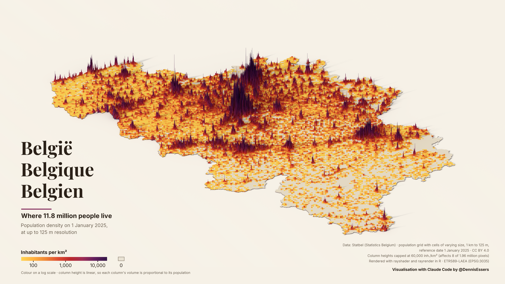

# België · Belgique · Belgien — where 11.8 million people live

A path-traced 3D map of Belgium's population density at up to **125 m resolution**,
built from Statbel's population grid with cells of varying size (reference date **1 January 2025**)
and rendered with [rayshader](https://www.rayshader.com/) / rayrender in R.



**Interactive 3D version:** [Belgium Population Relief](https://claude.ai/artifact/S6bUaCYEPtcC8vsczze6wf), source in `web/`.
- Every populated Statbel cell (117,352) is a column you can rotate, tilt and zoom.
- Hover or tap a column to see its municipality, density and residents.
- You can change the column height (linear or square root), the sun direction and the city labels.
- Built with three.js. The data comes from `R/06_web_data.R` → `web/data/be_cells.json`.

## Data

| What | Source | Notes |
|---|---|---|
| Population | Statbel, *Datalab – population grid with cells of varying size 2025* | 124,669 cells of 1 km, 500 m, 250 m or 125 m; EPSG:3035; 11,817,897 people |
| Country outline, municipality names (QA only) | Statbel, *Statistical sectors 2025* | 20,781 sectors, EPSG:3812 |

Both are Statbel open data under **CC BY 4.0**. Exact URLs, file sizes and SHA-256 hashes are written to
`data/raw/MANIFEST.csv` by `R/01_download.R`.

**Read the map with these caveats:**
- **Cell size isn't a design choice.** Statbel splits a 1 km cell into four only if each part keeps
  ≥ 10 people and ≥ 5 households. Dense areas therefore show 125 m detail, while rural areas show
  250 m–1 km plateaus.
- **Some households are moved slightly.** To meet the confidentiality rules, Statbel relocates a few
  households to a neighbouring cell in the same statistical sector ("geographical disruption").
- **A small share of people is missing.** About 7,700 people (0.065% of the official 11,825,551)
  could not be placed on the grid.
- **Who is counted:** the National Register population. That excludes asylum seekers and non-Belgians
  staying less than three months.

## Method

1. **Rasterise, keeping every person** (`R/02_prepare.R`).
   - Every 125 m pixel of an EPSG:3035 grid aligned to the 1 km lattice is assigned to the Statbel
     cell containing its centre.
   - Each cell's population is spread evenly over its own pixels. For full cells,
     density = `MS_POP / MS_KM2`. For cells clipped by the border, the pixel-approximated area is
     used instead, so tiny border slivers can't produce false spikes.
   - Cells too small to contain a pixel centre (112 cells, 247 people) are added to the pixel under
     their centroid.
   - The raster's total equals the grid total exactly.
2. **QA** (`R/03_explore.R`).
   - Totals are checked against Statbel's official figure.
   - Municipality totals rebuilt from the raster match the published ones (Antwerp 561k,
     Ghent 274k, Charleroi 204k, Liège 199k…).
   - The densest pixels are all in central Brussels, Liège and Ghent.
3. **Render** (`R/04_render.R`).
   - **Height** is linear in density, so each column's volume is proportional to the number of
     people living there. 8 of 1.96 million pixels exceed 60,000 inh./km² and are capped at that
     height, so they don't dwarf everything else.
   - **Colour** follows log₁₀(density), stretched between the 25th and 99.9th percentile of
     populated pixels. Unpopulated land is pale stone.
   - The matrix is upsampled ×2 with nearest neighbour, so cells render as crisp columns rather
     than tents. Flat plateaus are merged by mesh triangulation.
   - Path-traced with rayrender: one warm low key light from the WSW plus a uniform ambient fill.
4. **Finish** (`R/05_annotate.R`).
   - A flat-field correction fitted to the empty ground removes the light fall-off and makes the
     background exactly `#F6F1E7`.
   - Title, legend and credits are added as a ggplot overlay (Playfair Display and Inter, both
     under the SIL Open Font License).

## Reproduce

Requires R ≥ 4.6. On Windows, R was installed with `winget install RProject.R`.

```sh
Rscript R/00_install.R            # CRAN packages; writes logs/sessionInfo.txt
Rscript R/01_download.R           # Statbel files -> data/raw/, MANIFEST.csv
Rscript R/02_prepare.R            # -> data/processed/be_popdens_125m_20250101.tif
Rscript R/03_explore.R            # QA report + maps -> output/qa/
Rscript R/04_render.R stage=final # 8K path trace -> output/final/  (see config.R for the look)
Rscript R/05_annotate.R in=output/final/<render>.png out=output/final/belgium_population_density
```

Use `stage=snapshot` or `stage=draft` for quick previews. Any setting can be overridden on the command
line, e.g. `palette=Hokusai2 camera=C peak=0.12 zoom=0.5`.

> **Windows note:** don't pass multi-line code to `Rscript -e`. On this machine it segfaults before
> running anything, so always use script files.

## Attribution

Statbel's open data licence (CC BY 4.0) requires attribution. Keep "Data: Statbel" with every published copy of the map. The fonts are Playfair Display and Inter (Google Fonts, SIL Open Font License).
